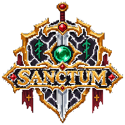

<p align="center">
  
</p>

<h1 align="center">SANCTUM</h1>

<p align="center">
  <b>Fortaleza Sagrada de Testes, Auditoria & Conclave Autônomo de QA</b><br>
  <i>Incursões táticas de qualidade em software operadas por agentes de IA com verificação implacável e aprovação soberana.</i>
</p>

<p align="center">
  
  
  
  
  
</p>

---

## 🛡️ O que é o SANCTUM?

O **SANCTUM** é um agente autônomo e orquestrador local de QA que roda integrado a ferramentas de IA (**Claude Code**, **Google Antigravity** e **Codex local**). 

Ele transforma a garantia de qualidade de software em uma **incursão tática de RPG Dark Fantasy**:
* **A Comitiva de Campeões:** Seus agentes autônomos de IA (*Arquimago Antigravity*, *Ladino Claude*, *Paladino Codex*) descem às profundezas do sistema, operam o navegador, investigam consoles, inspecionam requisições de rede e catalogam falhas.
* **O Mestre do Santuário (Você):** Mantém o controle soberano do sistema. Nenhuma ação destrutiva é executada sem autorização, e os planos de teste são aprovados por você com **1 clique**.
* **Painel Salão de Guerra (Cockpit 16-bit):** Interface tática em tempo real servida localmente (`http://127.0.0.1:4777`), zero-scroll, com gamificação completa, Bestiário de Bugs colecionáveis, cálculo dinâmico da Blindagem da Fortaleza e notificações sonoras e nativas do Windows.

---

## ⚡ Regras Sagradas que o Código Garante

1. **Nenhum PASSED Sem Prova:** Um cenário de teste só pode ser marcado como `PASSED` se uma asserção for fisicamente executada e registrada pela ferramenta `verify`. Sem verificação, a aprovação é rejeitada pelo núcleo.
2. **Action Guard & Proteção de Produção:** Ações de risco (*RED*, como pagamentos, exclusões e mutações de banco) são retidas pelo guardião até a autorização explícita do usuário. Em ambientes do tipo `prod`, mutações de escrita são permanentemente bloqueadas.
3. **Segredos Nunca Vazados:** Senhas e tokens residem exclusivamente no `.env` local e são referenciados apenas por alias (`secret:NOME` ou `role:usuario.password`). Toda e qualquer saída (terminal, prints, logs e relatórios) passa pelo sanitizador de redação.
4. **Isolamento Total:** Todo o banco SQLite (`data/novo-qa.db`), vídeos, capturas de tela e relatórios gerados permanecem 100% locais na sua máquina, fora do git.

---

## 📋 Pré-Requisitos

Antes de iniciar, certifique-se de possuir em sua máquina:

* **Node.js:** Versão `>= 22.13` (testado e homologado no Node 22 e 24).
* **Git:** Para versionamento e clone do repositório.
* **Navegador para Automação:** Chromium gerenciado pelo Playwright.
* **Agente de IA Suportado:**
  * [Claude Code](https://claude.com/claude-code) (CLI, extensão do VS Code ou Desktop)
  * [Google Antigravity](https://antigravity.google) (com suporte nativo a MCP)
  * [Codex local](docs/CODEX.md)
* **Jira / Confluence:** Atlassian MCP conectado ao seu cliente de IA ou TWG local para leitura direta de cards.

---

## 🚀 Instalação Passo a Passo

### 1. Clonar o Repositório e Instalar Dependências
```bash
git clone <url-do-repositorio>
cd "NEW QA"
npm install
```

### 2. Instalar os Binários do Navegador Playwright
```bash
npx playwright install chromium
```

### 3. Configurar as Variáveis de Ambiente (`.env`)
Copie o arquivo de exemplo e defina suas credenciais locais:
```bash
cp .env.example .env
```
Abra o `.env` no seu editor e configure as chaves necessárias:
```ini
# Configuração do Jira (Atlassian)
JIRA_HOST=https://seu-dominio.atlassian.net
JIRA_EMAIL=seu-email@dominio.com
JIRA_API_TOKEN=seu_token_api_atlassian

# Senhas dos Ambientes de Teste (NUNCA coloque no YAML nem no chat)
# Dica: Use aspas simples caso a senha contenha '#' ou caracteres especiais
GURUJA_DEV_ADMIN_PASSWORD='senha_do_admin'
GURUJA_DEV_ALUNO_PASSWORD='senha_do_aluno'
DUCO_DEV_PASSWORD='senha_do_ambiente_duco'
```

### 4. Diagnosticar a Saúde do Santuário
Execute o verificador do sistema para garantir que tudo está pronto:
```bash
npm run doctor
```
Se tudo estiver correto, o doutor validará Node.js, dependências, Playwright, arquivos de configuração e credenciais.

---

## 🏰 Central de Caça / Salão de Guerra ao Vivo

O SANCTUM possui um painel tático web ao vivo com estética **Dark Fantasy Pixel RPG 16-bit**.

### Iniciar o Painel:
```bash
npm run live
```
Abra em seu navegador: **`http://127.0.0.1:4777`**

### Funcionalidades do Cockpit:
* **Salão Tático (Zero-Scroll):** Terminal Tático e Comitiva de Heróis dispostos lado a lado (50%/50%) para visualização simultânea de conversas e logs.
* **Aprovações Rápidas em 1 Clique:** Detecção inteligente de pedidos de permissão (`write_file`, rituais) com botões rápidos `[✔ AUTORIZAR]` e `[✖ NEGAR]` para prosseguir sem digitação manual.
* **Covil das Bestas & Grimório:** Cartas de monstros colecionáveis categorizadas por raridade (*Maldito, Espectral, Abissal, Ancestral*) com fotos de evidências e pontuação de dano/XP.
* **Blindagem da Fortaleza (0-100%):** Medidor dinâmico da saúde da release com base na taxa de sucesso dos cenários provados.
* **Glórias da Ordem:** Sistema de 20 conquistas e troféus épicos em 4 patamares de dificuldade (*Tier I · Bronze, Tier II · Prata, Tier III · Ouro e Tier IV · Mítico/Lendário*).
* **Sinais & Notificações:** Áudio sintetizado via Web Audio API (Corneta Heróica e Sino de Sangue da Masmorra) e notificações nativas do Windows com o brasão oficial de SANCTUM.

---

## 🎮 Comandos de Operação via IA

Dentro do seu agente de IA (Claude Code, Antigravity ou Codex), no diretório do projeto:

| Comando | O que faz no Santuário |
| :--- | :--- |
| `/qa CARD-123` | **Incursão Completa:** lê o card no Jira, elabora plano tático por risco, aguarda seu aval, executa no navegador e gera relatório com evidências. |
| `/qa CARD-123 --explore` | **Reconhecimento Exploratório:** o mesmo fluxo, porém explorando caminhos alternativos, limites de campos e bordas do sistema. |
| `/qa CARD-123 --automate` | **Incursão com Automação:** ao final da execução manual bem-sucedida, gera e valida testes automatizados Playwright. |
| `/qa-resume CARD-123` | **Retomada de Expedição:** retoma um teste pausado ou interrompido exatamente da câmara onde parou. |
| `/retest CARD-123` | **Ritual de Expurgo:** retesta apenas os cenários que falharam no ciclo anterior e compara os resultados. |
| `/automate CARD-123` | **Forja de Automação:** transforma passos e evidências de um teste manual anterior em suite Playwright. |

---

## ⚙️ Configuração de Ambientes & Projetos

Os arquivos de configuração ficam na pasta `config/`:

* **`config/environments.yaml`**: Mapeamento de URLs, tipo de ambiente (`dev`, `staging`, `prod`), perfis de acesso e papéis de usuário. Senhas **sempre** referenciam variáveis do `.env`:
  ```yaml
  environments:
    duco-hml:
      project: duco
      type: staging
      baseUrl: https://pava2-duco-frontend.azurewebsites.net
      allowDataCreation: true
      roles:
        admin:
          username: admin_duco
          password: { env: DUCO_DEV_PASSWORD }
  ```
* **`config/projects.yaml`**: Mapeamento dos projetos atendidos e suas chaves do Jira (`GURUJA`, `DCTS`, etc.).
* **`config/qa-policy.yaml`**: Definição de regras de risco (ações GREEN vs RED), exigências de evidência e tolerância de anomalias.

---

## 🛠️ Comandos de Desenvolvimento & Auditoria

```bash
# Executa a suite de testes automatizados (Vitest)
npm test

# Validação estática de tipos TypeScript
npm run typecheck

# Diagnóstico de integridade do ambiente e configurações
npm run doctor

# Sobe aplicação fixture local (porta 4400) para testes de ferramentas
npm run fixture

# Executa bateria completa de auditoria E2E e performance
npx tsx scratch/test-full-audit.ts
```

---

## 📂 Estrutura do Repositório

```text
SANCTUM/
├── config/                  # Ambientes, projetos e política de segurança de QA
│   ├── environments.yaml    # URLs e mapeamento de perfis
│   ├── projects.yaml        # Chaves de projetos do Jira
│   └── qa-policy.yaml       # Classificação de ações de risco (RED vs GREEN)
├── data/                    # Banco SQLite compartilhado (data/novo-qa.db, gitignored)
├── docs/                    # Arquitetura, guias do Codex e decisões técnicas
├── knowledge/               # Base de conhecimento de execuções reutilizáveis por projeto
├── reports/                 # Relatórios HTML e Markdown gerados por card (gitignored)
├── runs/                    # Evidências: vídeos, screenshots, traces de rede (gitignored)
├── src/
│   ├── browser/             # Sessão Playwright, observadores de rede e console
│   ├── guard/               # Action Guard (salvaguarda de ações perigosas)
│   ├── live/                # Servidor do painel tático ao vivo e página HTML 16-bit
│   │   ├── sanctum-logo.png # Brasão oficial do SANCTUM
│   │   ├── page.html        # Interface Dark Fantasy Pixel RPG
│   │   ├── server.ts        # Servidor HTTP local (127.0.0.1:4777)
│   │   └── state.ts         # Cálculo de métricas, bestiário e 20 glórias multi-tier
│   ├── mcp/                 # Servidor MCP expondo as ferramentas para os agentes de IA
│   ├── security/            # Sanitização de dados, mascaramento de senhas e redação
│   └── state/               # Persistência em SQLite e regras de verificação
└── test/                    # Suite de testes unitários e de integração
```

---

<p align="center">
  <b>SANCTUM</b> · Protegido pela Ordem de QA · <i>Nenhuma falha passa pelo Santuário.</i>
</p>
